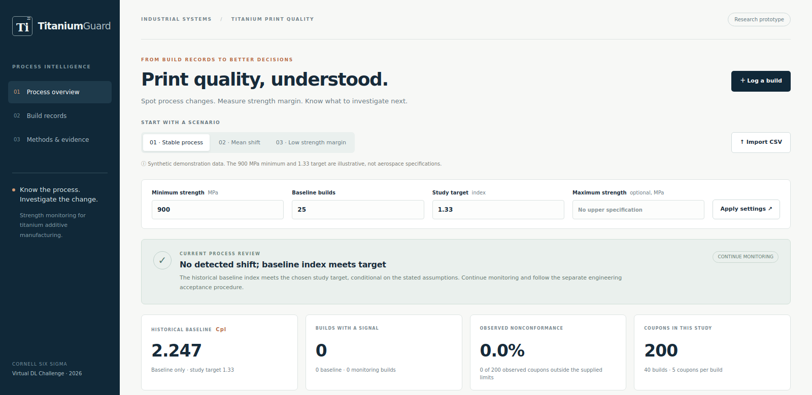
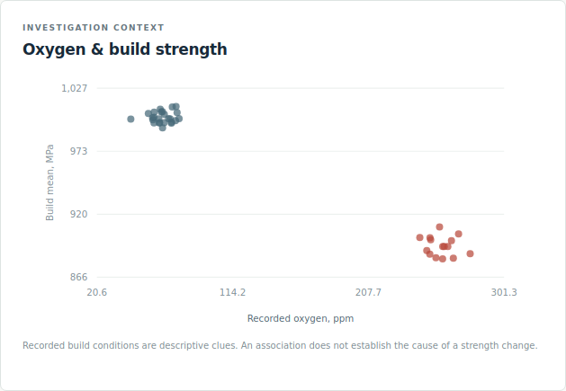

# TitaniumGuard
**Cornell Six Sigma Hackathon · Virtual DL · 3D Printing for Aerospace**

**Project owner and sole human participant: Yunkuan Liu.** Built with ChatGPT/Codex assistance; see [ownership, review and submission status](docs/OWNER_REVIEW.md).

**[Open the live application](https://connect.systems-apps.com/content/4e02952e-c744-4f24-8791-463876e0bcb5/)** · Public access, no login required.

A quality engineer's workbench for titanium coupon-strength monitoring. Log builds, freeze a reference baseline, detect process shifts, and compare baseline strength margin with an engineering requirement. A transparent statistical core powers a same-origin browser interface.



*Actual application screenshot with synthetic demonstration data; captured from the same application code used by the live deployment.*

**Demo materials:** [three-scenario walkthrough](demo/README.md) · [English speaking script](docs/PITCH.md) · [video-preview details](docs/DEMO_PREVIEW.md). A 2 min 29 sec English-captioned screen recording is available separately as `TitaniumGuard_Demo_EN.mp4` (no audio). Video upload instructions and the current submission status are linked above.

## Start in one command
Requires Python 3.12, a terminal and internet for the first dependency installation. Unzip/open the project folder, then:
```bash
bash app/testme.sh
```
Open the local address printed in the terminal, normally `http://127.0.0.1:8000`. The script creates a project `.venv` and installs the pinned application requirements on its first run. Stop with Ctrl+C. On Windows use WSL/Git Bash, or create a virtual environment, install `app/requirements.txt`, then run `python -m uvicorn app.server:api --host 127.0.0.1 --port 8000` from this folder.

For a read-only demonstration without Python, open [demo/TitaniumGuard_Demo.html](demo/TitaniumGuard_Demo.html). It switches among three already-computed scenarios; it does not perform new analyses. The full app is required for upload and logging.

## What the quality engineer does
1. Select a synthetic demonstration, upload CSV, or add a complete build through the logging form.
2. Enter the client-approved minimum strength (MPa), number of reference builds, and study target. Leave the optional upper limit blank unless an actual upper specification exists.
3. Inspect the R chart, then X-bar, then historical baseline capability. A signal blocks a current-process capability endorsement even if the historical index is high.
4. Investigate flagged builds using the recorded machine, powder, oxygen and recipe information. The tool shows descriptive context; it does not identify a cause.
5. Export the supported CSV fields and analysis JSON. Build entries are held in the current browser session; export before navigating away. There is no shared database.

## Minimal data contract
Four columns are required:
| Column | Meaning |
|---|---|
| build_id | One build/rational subgroup; rows must be contiguous |
| build_time | ISO 8601 timestamp, identical within a build and increasing between builds |
| specimen_id | Unique independent destructive-test coupon identifier |
| strength_mpa | Positive finite ultimate tensile strength in MPa |

Optional build-level fields: machine_id, powder_lot, oxygen_ppm, laser_power_w, scan_speed_mm_s, heat_treatment, notes. Unknown CSV columns and JSON record fields are rejected, so a misspelled field cannot silently disappear. Identifiers and text metadata must be strings. LF, CRLF and CR line endings are accepted. Equal subgroup size 2–10 is required; demos use 5. Supplied metadata must be consistent within a build. Mixed machines or heat-treatment routes are rejected. The detailed [codebook and real collection protocol](data/README.md) explains what technicians can record without telemetry and what a real qualified study additionally requires.

## Statistics and interpretation
The first B builds estimate frozen Xbar/R limits using rounded NIST A2, D3, D4 constants. Within-subgroup sigma is Rbar/d2. The app flags a mean/range outside its 3-sigma limits and the eighth and subsequent Xbar points strictly on one side of the center; it does not claim to implement every Western Electric rule.

- Minimum-only strength specification: **Cpl**, `(baseline_mean-LSL)/(3*within_sigma)`.
- Actual two-sided specification: also Cp, Cpu, Cpk; Cpk is the worse side.
- Ppl/Ppu/Pp/Ppk substitute baseline sample SD (ddof = 1) and are labeled as overall performance.
- Reported capability and performance estimates are from the historical baseline only. Observed nonconformance is separately counted for baseline, monitoring and all coupons.
- Baseline instability, monitoring signals or fewer than 25 baseline builds prevent a qualified target assessment. The 25-build threshold is an explicit prototype study policy, not a universal certification standard.
- A baseline Q-Q plot supports visual normality review. Approximate normality, independent and representative samples, rational subgrouping and measurement adequacy remain assumptions requiring engineering review.

The app never estimates specifications from the observations, drops incomplete rows silently, normalizes a shift by recalculating limits, or predicts defect rates from an unstable process. Zero variation and malformed records produce clear errors.

## Environmental context and the aerospace prompt
The full application already includes an **Oxygen & build strength scatter plot**, below the X-bar/R charts and beside the baseline Q-Q plot. Its x-axis is recorded chamber oxygen (ppm); its y-axis is mean coupon strength per build (MPa). Each point is one build, with control-signal builds colored red. Hovering identifies the build and its coordinates. Missing oxygen readings are omitted from this plot only; they do not remove strength records from the analysis.



In `mean_shift.csv`, the 25 baseline builds form a higher-strength/lower-oxygen cluster and the 15 monitoring builds form a lower-strength/higher-oxygen cluster. Both changes were planted together in the synthetic generator. This is descriptive association, **not evidence that oxygen caused a strength change**. No correlation coefficient, regression significance or causal prediction is claimed. Laser power and scan speed remain recorded context; they are not fitted predictors. Coupon ultimate tensile strength is a process-quality proxy, not a finished-bracket load test or fatigue-life model.

This makes the environment/strength relationship visible while keeping the analysis within what the data support. A real investigation would review oxygen measurement, material lot, recipe and post-processing together, then validate a proposed cause in a designed study.

## Three demonstration fixtures
All observations are synthetic. LSL = 900 MPa and target = 1.33 are illustrative choices, not aviation/material standards. Seed 42 was selected for clean contrasting demonstrations; this is disclosed in the codebook.

| File | What to show | Historical baseline Cpl | Monitoring nonconforming |
|---|---|---:|---:|
| stable_capable.csv | No detected shift; baseline target met |2.246761|0/75|
| mean_shift.csv | Mean drops from B026; 15 builds flagged |2.246761|52/75|
| stable_incapable.csv | No detected shift; inadequate margin |0.418036|10/75|

The high baseline Cpl in the second row does **not** describe the changed process. Full computed values and the step-by-step demo are in [demo/README.md](demo/README.md).

## Reproduce and test
```bash
.venv/bin/python -m pip install -r app/requirements-dev.txt
.venv/bin/python -m pytest tests app/test_api.py -q
.venv/bin/python data/generate.py
.venv/bin/python demo/run_demo.py
.venv/bin/python demo/build_preview.py
```
The last verified full suite passed **109 tests**: **71 numerical/schema tests** under `tests/` plus **38 API tests** in `app/test_api.py`. API checks cover strict inputs, error responses and locally served documentation. See the [successful verification run](https://github.com/yl4499-beep/TitaniumGuard/actions/runs/39697302948); run the command above to verify your checkout. A separate AI-assisted read-only review recomputed the hand fixture, the C/P estimators, frozen-baseline behavior, run logic and invalid inputs. See [review evidence](demo/STATISTICS_REVIEW.md). No scoring claim or external accreditation is made.

`data/generate.py` is the authoritative generator. Before publishing changes to the data, copy the three generated CSVs to `app/sample_data/`, rerun tests and regenerate the deployment manifest. The packaged copies are identical.

## Function and API documentation
- `app.qc.parse_csv(text)`: UTF-8 CSV string to records; rejects malformed headers and incomplete rows.
- `app.qc.analyze_records(records, lsl=900, usl=None, baseline_builds=25, target=1.33)`: returns metadata, frozen limits, historical baseline C/P indices, per-build signals and context, observed counts, Q-Q points, status, recommendation and warnings. Inputs are not mutated. Invalid inputs raise ValueError.
- `app.qc.capability_indices(mu,sigma,lsl,usl,prefix='C')`: low-level formula helper; the caller supplies a positive finite appropriate sigma and validated specifications. `analyze_records` is the validated public analysis entry point.
- `GET /health`: application health/version.
- `GET /api/datasets`: three synthetic dataset descriptions.
- `GET /api/datasets/{name}`: CSV demonstration.
- `POST /api/analyze`: exactly one of `csv_text` or `records`, plus lsl, optional usl, integer baseline_builds and target. Validation failure returns HTTP 422. Prototype limit 20,000 records.
- `GET /docs`: interactive API documentation.

[App README](app/README.md) provides request examples and launch details.

## Live deployment and submission
**[Open TitaniumGuard](https://connect.systems-apps.com/content/4e02952e-c744-4f24-8791-463876e0bcb5/)** · [Public GitHub repository](https://github.com/yl4499-beep/TitaniumGuard).

TitaniumGuard was deployed on 2026-10-21 (Eastern) to the course Posit Connect server using **Publish → Import from Git**, branch `main`, directory `app`. Connect builds the committed manifest and manages Git-backed updates. The server used compatible Python 3.12.4. No publisher API key was created or copied for this deployment.

Anonymous checks passed for the homepage, `/health`, API documentation, all three CSV downloads and all three full analysis responses against the reviewed JSON fixtures. Empty input returns HTTP 422. See [deployment evidence](docs/DEPLOYMENT.md).

GitHub Actions separates two checks:
- `Check TitaniumGuard`: statistical/API tests and manifest/data consistency.
- `Verify public TitaniumGuard deployment`: public HTTP and exact fixture checks, without authentication.

The original official API-key deployment template remains available through **manual workflow dispatch only**. Do not run it alongside the native Git publisher: its name-based target may create a different app. It requires the two repository secrets and a deliberately reviewed migration/target. The earlier failed run is retained as history; the actual live deployment used Connect's Git integration.

Submission steps:
1. Use **Yunkuan Liu** as the project owner and sole actual participant. Use [the project description](docs/DEVPOST_DRAFT.md) for the matching Devpost fields.
2. Upload `TitaniumGuard_Demo_EN.mp4` to YouTube, set visibility to Public or Unlisted, and enter its viewing link in the Devpost **Video demo link** field. Include the GitHub and live application links, check the embedded video, and complete the hackathon submission.
3. The [official kickoff slides, slide 10](https://timothyfraser.com/sigma/slides/40_slides_recitation_8.html#10) also direct students to submit the **repository URL and Devpost project link on Canvas**. Check the actual Canvas assignment's deadline and upload fields.

The published DL schedule lists October 23, 2026, 3 PM Eastern. Video hosting and Devpost/Canvas submission have not yet been verified. See [ownership, review and eligibility status](docs/OWNER_REVIEW.md) for the current record. Deployment alone does not submit either form.

## Project contents
`app/` API/UI and deploy scripts; `data/` CSVs, generator, codebook; `tests/` statistical tests; `demo/` exact outputs, walkthrough and offline preview; `docs/` plan, sources, pitch, Devpost draft and Chinese guide. SPEC.md and CONTRACT.yaml track scope and remaining account tasks. Official agent workflow files are retained for continuation.

## Attribution and limitations
Sources, borrowed starter attribution and AI assistance disclosure are in [SOURCES](docs/SOURCES.md). ChatGPT/Codex assisted with design, code, test data, tests and documentation, as encouraged by the event. Yunkuan Liu has confirmed that he personally reviewed the project.

This is a process-monitoring educational prototype. Coupon strength does not establish individual bracket fitness or airworthiness. Production use needs validated sampling, measurements, audit records, access controls and qualified release procedures. No causal or failure prediction is made.

## Optional real-browser acceptance checks
```bash
.venv/bin/python -m pip install playwright==1.51.0
.venv/bin/python -m playwright install chromium
.venv/bin/python tests/browser_smoke.py
.venv/bin/python tests/check_release.py
```
On a minimal Linux system, Chromium may also need OS libraries (`playwright install --with-deps chromium`). Browser tooling is only for development. The acceptance script starts and stops its own local server and exercises root and reverse-proxy-prefixed routes. Swagger UI assets are vendored with their original license, so the app and interactive API documentation make no CDN request at runtime.

Changing study settings marks the displayed results as pending and blocks logging/export until the new settings are successfully applied. The logging form names the study timezone. Records still live only in browser-tab memory: export CSV before leaving, and import a real baseline before appending real measurements to a synthetic practice study.

中文说明：[GUIDE_ZH.md](docs/GUIDE_ZH.md). GitHub发布和真实留痕：[GITHUB_SUBMISSION_ZH.md](docs/GITHUB_SUBMISSION_ZH.md). 当前提交状态：[OWNER_REVIEW.md](docs/OWNER_REVIEW.md). 历史技术检查：[AUDIT_REPORT_ZH.md](docs/AUDIT_REPORT_ZH.md).
